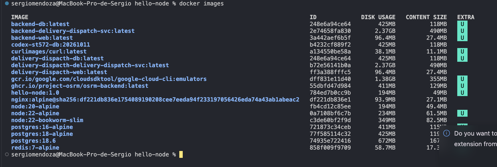
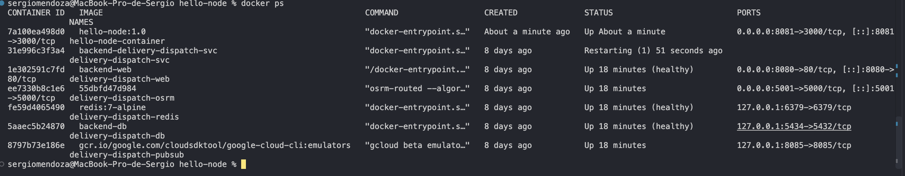
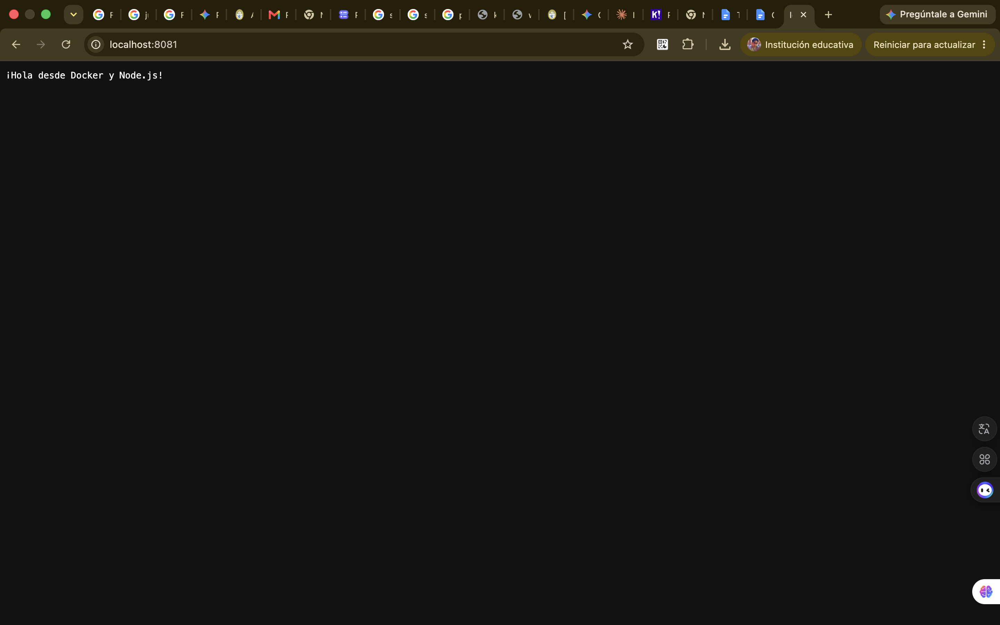

# hello-node

**Estudiante:** [Sergio Alexander Mendoza Choque]

## Descripción
Aplicación Node.js sencilla que inicia un servidor HTTP en el puerto 3000 y responde con el texto "¡Hola desde Docker y Node.js!". Se ejecuta dentro de un contenedor Docker construido a partir de un Dockerfile basado en `node:20-alpine`.

## Construir la imagen
```bash
docker build -t hello-node:1.0 .
```

## Ejecutar el contenedor
```bash
docker run -d --name hello-node-container -p 8080:3000 hello-node:1.0
```

## Verificación

### docker images

### docker ps

### Aplicación en el navegador (http://localhost:8080)
